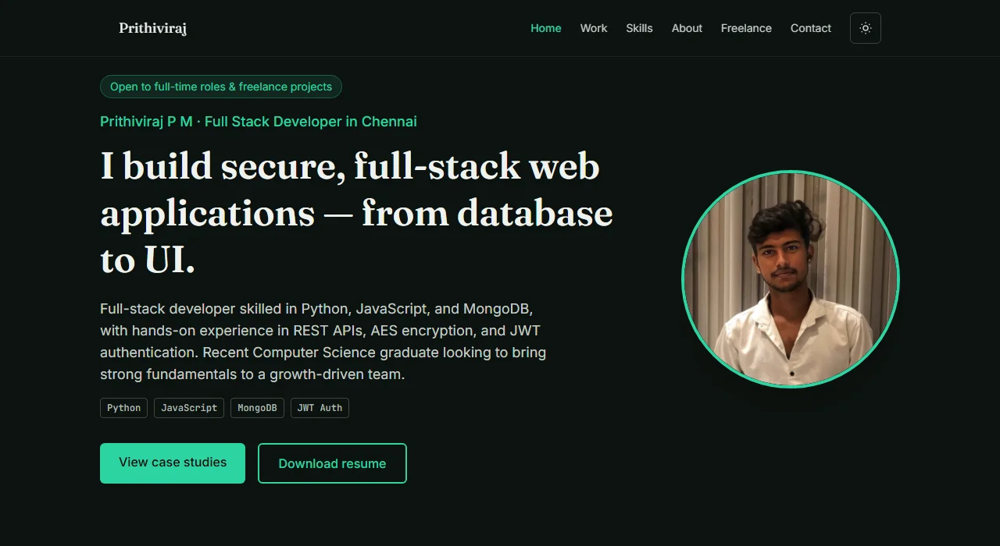
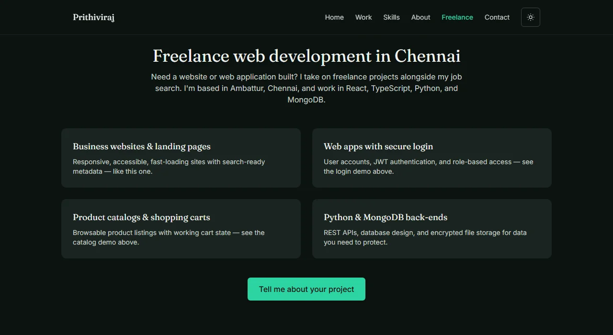

<h1 align="center">Hi, I'm Prithiviraj P M 👋</h1>
<h3 align="center">Full Stack Developer in Chennai · Python · React · MongoDB</h3>

<p align="center">
  <a href="https://digital-portfolio-nine-navy.vercel.app/">
    
  </a>
</p>

<p align="center">
  <a href="https://digital-portfolio-nine-navy.vercel.app/"></a>
  <a href="https://github.com/PMPrithiviraj/digital-portfolio/actions/workflows/seo-check.yml"></a>
  
  
</p>

---


- 🔭 Building **this portfolio**: live, interactive project demos instead of screenshots
- 🔐 Strongest project: **encrypted file storage** with AES-256 and JWT role-based access control
- 🎓 **B.Sc. Computer Science**, Sridevi Arts & Science College (University of Madras), 2026
- 📍 Based in **Ambattur, Chennai**, open to relocating
- 💼 Open to **full-time Software Developer roles** and **freelance projects**
- 📫 Reach me at **[pmprithiviraj@gmail.com](mailto:pmprithiviraj@gmail.com)**

<br clear="right" />

## Connect with me

<p>
  <a href="https://www.linkedin.com/in/prithivirajpm"></a>
  <a href="https://digital-portfolio-nine-navy.vercel.app/"></a>
  <a href="mailto:pmprithiviraj@gmail.com"></a>
  <a href="https://github.com/PMPrithiviraj"></a>
</p>

## Languages and tools

<p>
  
</p>

## Preview

<p align="center">
  
  
</p>

## What's inside

- **Live, interactive case studies**, each one the actual running component:
  - JWT-authenticated login form with real client-side validation
  - Product catalog with working cart state (`useReducer`)
- **Evidence-based skills section**: every skill is tied to a project, with no self-rated percentages
- **Dark/light theme** with persisted preference and no flash on load
- **Accessible**: WCAG AA, verified with axe-core; animations respect `prefers-reduced-motion`
- **Search-ready**: build-time prerendered HTML, JSON-LD (`ProfilePage` + `Person`), Open Graph/Twitter cards, sitemap, and robots.txt, guarded by an SEO regression check in CI

## Tech stack

| Layer | Tools |
| --- | --- |
| UI | React 19, TypeScript |
| Styling | Tailwind CSS v4 (CSS-first config, design tokens in `src/index.css`) |
| Motion | Framer Motion (scroll reveals) |
| Build | Vite, build-time prerender (`src/entry-server.tsx` → `scripts/prerender.mjs`) |
| Quality | ESLint, axe-core + Playwright, `npm run check:seo` |
| Hosting | Vercel |

## Getting started

```bash
npm install
npm run dev
```

Other scripts:

```bash
npm run build     # type-check + production build + prerender HTML into dist/index.html
npm run preview   # preview the production build locally
npm run check:seo # validate sitemap, robots, canonical, JSON-LD and prerendered content in dist/
npm run lint
```

`npm run build` prerenders the page at build time, so crawlers that don't run JavaScript still get the full content. The browser then renders the app normally with `createRoot`.

When content changes substantively, update `<lastmod>` in `public/sitemap.xml` and `dateModified` in the JSON-LD in `index.html`.

## Deployment

Deployed on Vercel. **Framework Preset:** Vite, **Root Directory:** repo root.

No environment variables or secrets are required. The site is fully static/client-side: the contact form opens a pre-filled `mailto:` link, and there is no backend.

---

<p align="center"><i>Built by Prithiviraj P M · Chennai</i></p>
